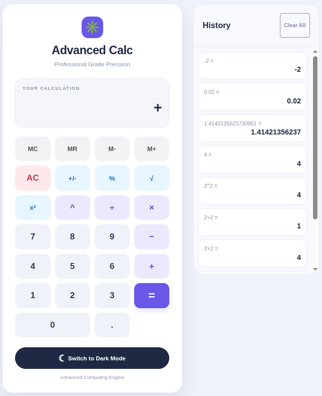
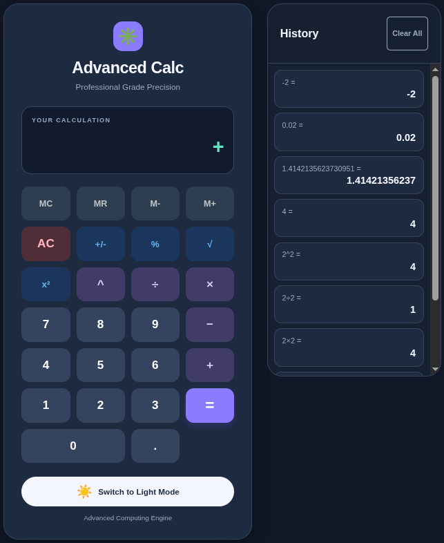

# Advanced Calculator

A professional-grade, high-precision calculator built with modern web technologies. This application features a sleek, responsive design and a powerful mathematical engine.

## 📸 Visual Preview

| Light Mode | Dark Mode |
| :---: | :---: |
|  |  |

## 🚀 Features

### 🧠 Advanced Mathematical Engine
- **Scientific Operations:**
  - **Percentage (`%`):** Instant decimal conversion.
  - **Sign Toggle (`+/-`):** Quickly switch between positive and negative values.
  - **Square Root (`√`):** Compute roots instantly.
  - **Exponentiation:** Support for both squaring (`x²`) and custom powers (`^`).
- **Memory Register System:**
  - `MC` (Clear), `MR` (Recall), `M+` (Add to memory), and `M-` (Subtract from memory) for complex multi-step calculations.
- **Robust Error Handling:**
  - Intelligent detection of division by zero with user-friendly messaging (`"Cannot divide by 0"`).
  - Automatic state reset on error to ensure continuous workflow.
  - Prevention of `NaN` and `Infinity` in the display.

### 📊 Interactive History
- **Calculation Log:** A dedicated sidebar tracks your recent calculation history.
- **Instant Reload:** Click any historical entry to instantly load that result back into the main display for further operations.
- **History Management:** Easily clear your history to start fresh.

### 🎨 Premium UI/UX
- **Theme Support:** Seamlessly toggle between **Light Mode** and **Dark Mode**.
- **Responsive Design:** Optimized for desktop, tablet, and mobile devices.
- **Keyboard Integration:** Full physical keyboard support for a seamless, "pro" user experience.
- **Semantic Structure:** Built with clean, accessible HTML and organized CSS grid layouts.

## 🛠️ Technologies Used

- **HTML5:** Semantic structure and accessibility.
- **CSS3:** Advanced Grid/Flexbox layouts, CSS Variables (Theming), and responsive media queries.
- **JavaScript (ES6+):** Modular engine design, event delegation, and complex state management.

## 🚀 How to Run

1. Clone this repository or download the source files.
2. Open `index.html` in any modern web browser.
3. Start calculating!
